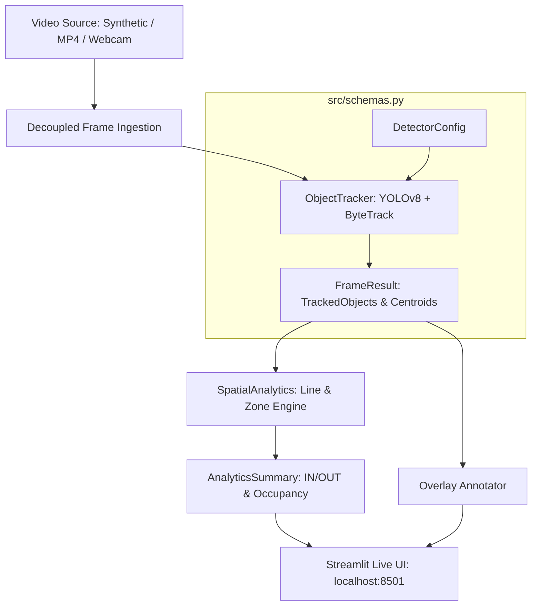

# Real-Time Object Detection & Tracking Dashboard

A containerized, production-grade computer vision application for real-time object detection, multi-object tracking, and spatial analytics. Built with **Ultralytics YOLO (v8/v11)**, **ByteTrack**, **OpenCV**, **Pydantic v2**, and **Streamlit**, fully isolated inside **Podman** using **uv**.

---

## Key Features

- **Multi-Object Tracking (MOT)**: State-of-the-art tracking via ByteTrack and BoT-SORT with persistent track IDs across frames and sub-pixel bounding box clamping.
- **Directional Line-Crossing Counting**: Vector cross-product intersection calculation that classifies directional `IN` and `OUT` events per track ID, preventing jitter and duplicate triggers.
- **Spatial Zone Occupancy**: Real-time point-in-polygon containment analysis reporting live headcounts within designated regions of interest (ROI).
- **Interactive Streamlit Dashboard**: Live visual overlays (bounding boxes, track IDs, centroid motion trails, line coordinates, zone polygons), metric scorecards, dynamic class filtering, and event tables.
- **Flexible Video Feeds**: Supports synthetic mock video streams (zero camera required), uploaded video files, pre-recorded test footage, and live webcams.
- **Custom Fine-Tuning Pipeline**: CLI-driven training pipeline supporting both local dataset YAMLs and direct Roboflow dataset version downloads with automated dry-run smoke validation.
- **Strict Pydantic v2 Data Contracts**: Every inter-module boundary is validated with immutable, frozen Pydantic v2 schemas (`extra="forbid"`).
- **100% Containerized**: Enforces headless OpenCV (`opencv-python-headless`) inside rootless Podman containers without host dependencies.

---

## Architecture & System Flow



---

## Project Structure

```text
object-tracking-dashboard/
├── .containerignore            # Files excluded from Podman image context
├── .gitignore                  # Git exclusions (weights, caches, media, venv)
├── compose.yaml                # Podman Compose service definition
├── Containerfile               # Multi-stage container build with uv & Python 3.12
├── Makefile                    # Cross-platform build & run automation
├── pyproject.toml              # Project dependencies, Hatchling build, Ruff & Pytest config
├── README.md                   # Project documentation & runbook
├── SPEC.md                     # Engineering specification & acceptance criteria
├── uv.lock                     # Deterministic dependency lockfile
├── app.py                      # Interactive Streamlit Live Dashboard application
├── data/                       # Directory for sample & uploaded video files
│   └── .gitkeep
├── models/                     # Export directory for trained YOLO weights
│   └── .gitkeep
├── src/                        # Core application modules
│   ├── __init__.py             # Package exports (lazy-loaded CLI bindings)
│   ├── counter.py              # SpatialAnalytics (cross-product lines & polygon zones)
│   ├── schemas.py              # Pydantic v2 domain schemas & configs
│   ├── tracker.py              # ObjectTracker (YOLOv8 + ByteTrack wrapper)
│   └── train.py                # Model fine-tuning & Roboflow ingestion CLI
└── tests/                      # Automated headless Pytest test suite (237 tests)
    ├── conftest.py             # Shared synthetic fixtures (numpy frames, mock boxes)
    ├── test_app.py             # Dashboard helper & UI logic tests
    ├── test_counter.py         # Vector cross-product & zone occupancy tests
    ├── test_schemas.py         # Pydantic v2 validation constraint tests
    ├── test_tracker.py         # Inference engine & tracking logic tests
    └── test_train.py           # Training CLI & Roboflow integration tests
```

---

## Getting Started

### Prerequisites
- [Podman](https://podman.io/) (v4.0+) or Podman Desktop installed on your host.
- Optional: GNU `make` (included by default on macOS/Linux/WSL).

> **Note**: Host Python installations are never required. All execution, testing, and linting happen inside the Podman container.

---

## Running the Application

### 1. Launch the Dashboard via Makefile

From **WSL** or **Linux/macOS**:
```bash
make run
```
From **Windows PowerShell**:
```powershell
wsl make run
```

### 2. Launch the Dashboard via Direct Podman Command

If running directly from Windows PowerShell without `make`:
```powershell
podman run --rm -it -p 8501:8501 -v "${PWD}:/app:Z" object-tracking-dashboard-app uv run streamlit run app.py --server.port=8501 --server.address=0.0.0.0 --server.headless=true
```

Once started, navigate to:
**`http://localhost:8501`**

---

## Makefile Command Reference

The included `Makefile` automatically adapts to native Linux Podman or Windows `podman.exe` and handles host-to-container volume translation.

| Target | Command Executed | Purpose |
| :--- | :--- | :--- |
| `make help` | Display help | List all targets with runtime diagnostics |
| **`make run`** / **`make dev`** | `uv run streamlit run app.py` | **Launch live Streamlit dashboard on port 8501** |
| `make test` | `uv run pytest -v` | Execute full automated test suite (237 tests) |
| `make test-unit` | `uv run pytest -v --tb=short` | Run tests with compact tracebacks |
| `make test-cov` | `uv run pytest --cov=src` | Run tests with coverage breakdown |
| `make check` | `ruff check` + `ruff format --check` | Run linter and formatting checks |
| `make format` | `uv run ruff format .` | Auto-format codebase using Ruff |
| `make lint` | `uv run ruff check .` | Lint codebase using Ruff |
| `make train-dry-run` | `python -m src.train --dry-run` | Validate fine-tuning pipeline configuration |
| `make shell` | `/bin/bash` | Open an interactive container shell |
| `make build` | `podman build -t ...` | Rebuild the Podman container image |
| `make clean` | `rm -rf ...` | Clear caches (`.pytest_cache`, `.ruff_cache`, `runs/`) |

---

## Fine-Tuning Custom YOLO Models

The project includes an integrated fine-tuning script (`src/train.py`) supporting local datasets and direct Roboflow cloud downloads:

### Local Dataset Training
```bash
# Inside container or via make
podman compose run --rm app uv run python -m src.train \
    --data data/custom_dataset.yaml \
    --model yolov8n.pt \
    --epochs 50 \
    --batch 16 \
    --imgsz 640 \
    --output-dir models/
```

### Roboflow Dataset Ingestion & Training
```bash
podman compose run --rm app uv run python -m src.train \
    --roboflow-api-key "YOUR_API_KEY" \
    --roboflow-workspace "your-workspace" \
    --roboflow-project "your-project" \
    --roboflow-version 1 \
    --epochs 30 \
    --output-dir models/
```

### Dry-Run Validation (Smoke Test)
```bash
make train-dry-run
```

---

## Core Modules & Schemas

### 1. `src/schemas.py`
Defines strict Pydantic v2 schemas:
- `DetectorConfig`: Model path, confidence threshold, IoU threshold, class filters, tracker type (`bytetrack.yaml` or `botsort.yaml`).
- `TrackedObject`: Track ID, class ID, class name, detection confidence, clamped bounding box `(x1, y1, x2, y2)`, and centroid `(cx, cy)`.
- `FrameResult`: Frame index, inference latency (`ms`), calculated FPS, and list of `TrackedObject` instances.
- `CountingLine`: Directional line defined by `start_point` and `end_point`.
- `CountingZone`: Closed polygon defined by vertices `[(x, y), ...]`.
- `AnalyticsSummary`: Aggregated counts (`total_in`, `total_out`, `zone_occupancy`, `class_counts`).

### 2. `src/tracker.py`
Encapsulates Ultralytics YOLO with tracking persistence:
- Disables non-headless GUI display.
- Enforces coordinate clamping to prevent negative regression artifacts.
- Measures inference and tracking latency on each tick.

### 3. `src/counter.py`
Performs robust spatial calculations:
- **Vector Cross-Product**: Evaluates sign changes $\vec{AB} \times \vec{AC}$ between consecutive centroids across line segments.
- **Trajectory History**: Keeps a ring buffer of past positions per track ID to prevent stationary flutter double-counts.
- **Point-in-Polygon**: Uses OpenCV `pointPolygonTest` to count real-time zone occupancy.

### 4. `app.py`
Streamlit application featuring:
- **Feed Selectors**: Built-in synthetic particle video generator, local file selector, file uploader, and webcam stream.
- **Interactive Controls**: Dynamic confidence/IoU threshold sliders, line coordinates, and polygon vertex editors.
- **Real-Time Visualizer**: Non-blocking rendering loop drawing motion trails, bounding boxes, and spatial counters.

---

## Testing & Quality Assurance

All tests run headlessly without physical display or GPU hardware:
```bash
make test
```

Expected result:
```text
============================= 237 passed in 2.14s ==============================
```

To run formatting and linting checks:
```bash
make check
```

---

## License

This project is licensed under the Apache 2.0 License.
